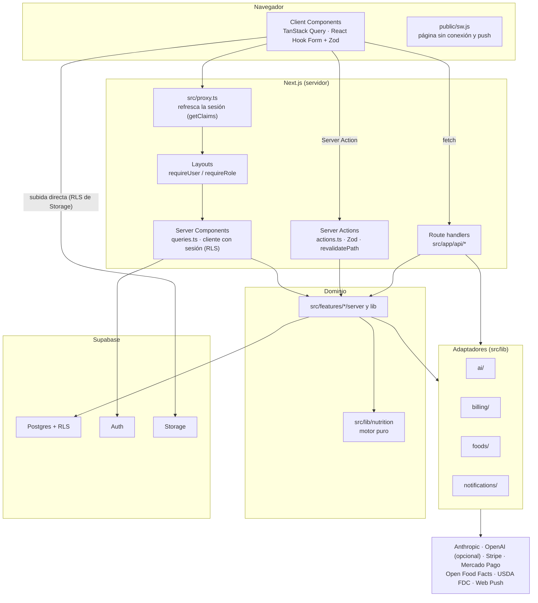

# Arquitectura — ORANGE FIT

Cómo está armada la app hoy, contrastado con el código. Si algo de aquí no coincide con el código,
manda el código: corrige este documento. Reglas de código en `docs/CONVENTIONS.md`, tablas y
funciones en `docs/DATA_MODEL.md`, seguridad en `docs/SECURITY.md`.

## 1. Visión general

Una sola app Next.js 16.4 (App Router, React 19, TypeScript) hace de sitio público, app del usuario,
panel admin y backend (Server Actions y route handlers). Los datos viven en Supabase: Postgres con
RLS en todas las tablas de `public`, Auth y Storage. Cada servicio externo entra por un adaptador en
`src/lib/*`. Si falta su credencial, el adaptador lo dice («pendiente de configurar», HTTP 503) y no
inventa un resultado.



| Capa | Dónde | Qué hace |
|---|---|---|
| Navegador | `src/features/*/components`, `src/components` | Formularios, búsqueda en vivo, cámara, chat, temporizadores. Solo conoce la clave pública de Supabase. |
| Borde | `src/proxy.ts` → `src/lib/supabase/proxy.ts` | Refresca las cookies de sesión y manda a `/ingresar` a quien entra a `/app` o `/admin` sin sesión. No autoriza nada más. |
| Páginas | `src/app/**` | Delgadas: guarda de sesión o rol, lectura con `queries.ts` o `server/`, render de componentes. |
| Escrituras | `src/features/*/actions.ts`, `src/app/api/**` | Sesión, Zod, escritura con RLS, `revalidatePath`, `ActionResult` o JSON `{ error: { code, message } }`. |
| Dominio | `src/features/*/server`, `src/features/*/lib` | Operaciones que reciben el cliente de Supabase ya creado; lógica pura del módulo. |
| Motor | `src/lib/nutrition` | Fórmulas y reglas nutricionales sin I/O. |
| Adaptadores | `src/lib/{ai,billing,foods,notifications}` | Claude, pagos, bases de alimentos, push. |
| Datos | `supabase/migrations`, `supabase/seed` | Tablas, RLS, funciones, Storage y datos base. |

## 2. Estructura de carpetas

```
orange-fit/
├─ src/
│  ├─ proxy.ts                  sesión y protección de /app y /admin (en Next 16 reemplaza a middleware)
│  ├─ app/
│  │  ├─ layout.tsx             raíz: fuentes, Providers, metadatos e iconos, registro del service worker
│  │  ├─ (marketing)/           portada, /funciones, /faq, /legal/[slug]
│  │  ├─ precios/               precios públicos (módulo pagos)
│  │  ├─ (auth)/                /ingresar, /registro, /verificar, /recuperar, /nueva-clave
│  │  ├─ auth/                  route handlers: confirm (correo), callback (Google), salir
│  │  ├─ onboarding/            asistente de 21 pantallas; funciona sin sesión
│  │  ├─ app/                   área del usuario; (inicio)/ es /app con su propio loading.tsx
│  │  ├─ admin/                 panel (layout exige editor; cada página exige su rol)
│  │  ├─ compartido/plan/[token]/  plan compartido público vía get_shared_plan
│  │  ├─ api/                   account, ai, billing, cron, errors, foods, plan, push
│  │  ├─ manifest.ts · sitemap.ts · robots.ts · opengraph-image.tsx
│  │  └─ error.tsx · global-error.tsx · not-found.tsx
│  ├─ features/<módulo>/        activity, admin, ai, assistant, auth, billing, dashboard, diary,
│  │                            fasting, foods, gamification, marketing, notifications, onboarding,
│  │                            planner, profile, progress, recipes, shopping, water
│  │     actions.ts             Server Actions ("use server")
│  │     queries.ts             lecturas de servidor ("server-only")
│  │     schemas.ts             Zod compartido entre cliente y servidor
│  │     server/                operaciones con el cliente inyectado ("server-only")
│  │     lib/                   lógica pura del módulo, con pruebas al lado
│  │     components/            UI del módulo
│  ├─ components/               ui/ (primitivas Radix + cva), app/, admin/, marketing/, brand/, pwa/,
│  │                            providers.tsx, setup-required.tsx
│  └─ lib/
│     ├─ nutrition/             motor nutricional puro
│     ├─ ai/ billing/ foods/ notifications/   adaptadores de servicios externos
│     ├─ supabase/              client.ts (navegador), server.ts (sesión), admin.ts (service role), proxy.ts
│     ├─ auth/session.ts        getUser, requireUser, getProfile, getRoles, hasRole, requireRole
│     ├─ config/app-settings.ts nombre de la app, correo de soporte, banderas (tabla app_settings)
│     ├─ data/targets.ts        getActiveTargets, getActiveGoal
│     ├─ db/database.types.ts   tipos generados (npm run db:types); no se edita a mano
│     ├─ env.ts · server-env.ts variables públicas / solo de servidor, validadas con Zod
│     └─ action-result.ts · dates.ts · format.ts · initials.ts · utils.ts
├─ supabase/
│  ├─ config.toml               Supabase local (Auth, Storage, plantillas de correo)
│  ├─ migrations/               14 migraciones (tabla abajo)
│  ├─ seed/                     00_base, 10_foods, 20_recipes, 30_reference_prices
│  └─ templates/                confirmation.html, recovery.html (enlaces con token_hash)
├─ public/                      sw.js, offline.html, icons/, screenshots/, favicon.ico
├─ scripts/                     generate-icons.mjs, import-usda.ts, capture-screenshots.ts, check-seed.mjs
└─ tests/                       unit/, integration/, e2e/, stubs/ (+ *.test.ts junto al código)
```

`docs/CONVENTIONS.md` describe un módulo con `components/`, `actions.ts`, `queries.ts` y `schemas.ts`. En
la práctica casi todos suman `server/` (I/O con el cliente que se les pasa) y `lib/` (funciones puras).

| Migración | Contenido |
|---|---|
| `20261013000001_extensions_enums_helpers` | Extensiones, enums, `set_updated_at`, `normalize_text` |
| `…0002_users` | `profiles`, `user_roles`, `consents`, `user_goals`, `nutrition_targets`, `professional_access`; `has_role`, `has_professional_access`, `handle_new_user` |
| `…0003_foods` | `brands`, `foods`, `nutrient_definitions`, `food_nutrients`, `food_portions`, `reference_prices` y triggers de búsqueda |
| `…0004_recipes_logs_plans` | Recetas, diario, plantillas, favoritos, planes, compras; vistas `recipe_nutrition` y `daily_nutrition_totals` |
| `…0005_tracking` | Agua, peso, medidas, fotos de progreso, ayuno, ejercicio |
| `…0006_ai_notifications_gamification` | Solicitudes de IA, asistente, notificaciones, push, insignias y retos |
| `…0007_billing` | `plans`, `plan_prices`, `subscriptions`, `payments`, `billing_events` |
| `…0008_admin` | `app_settings`, `content_pages`, `admin_audit_logs`, `error_reports`, `rate_limits` |
| `…0009_functions` | RPC (`is_premium`, `consume_ai_quota`, `check_rate_limit`, `search_foods`…) y triggers de integridad |
| `…0010_rls` | RLS en todas las tablas |
| `…0011_storage` | Buckets y políticas por carpeta `{user_id}/` |
| `…0012_grants` | Permisos de ejecución de funciones y tablas cerradas a la API |
| `20261013100801_admin_panel` | `admin_ai_usage`, `admin_merge_foods`, `recipes.review_note` y aviso al autor |
| `20261013110001_integration_professional_target_notice` | Aviso a la persona cuando su profesional fija una meta |

## 3. Cómo fluye una petición

Ejemplo real: abrir `/app/agua` y registrar 250 ml.

```mermaid
sequenceDiagram
  autonumber
  participant B as Navegador
  participant P as src/proxy.ts
  participant L as src/app/app/layout.tsx
  participant G as src/app/app/agua/page.tsx
  participant A as features/water/actions.ts
  participant DB as Supabase (RLS)
  B->>P: GET /app/agua (cookies)
  P->>DB: auth.getClaims() y refresco de cookies
  P-->>B: sin sesión → 307 a /ingresar?next=/app/agua
  P->>L: con sesión
  L->>DB: requireUser() → auth.getUser(); getProfile()
  L-->>B: sin onboarding_completed_at → /onboarding
  L->>G: render
  G->>DB: getTrackingContext() + getWaterPageData() con el cliente de sesión
  G-->>B: HTML (Server Components)
  B->>A: addWaterAction({ amountMl: 250 })
  A->>DB: requireUser() → Zod → insert water_logs (user_id = sesión)
  A->>A: revalidatePath("/app", "layout") · after(syncAchievementsSafely)
  A-->>B: ActionResult { ok, data }
```

Paso a paso:

1. **`src/proxy.ts`** corre en casi todas las rutas (excluye estáticos, iconos, `manifest.webmanifest`,
   `sw.js` y `offline.html`). Crea un cliente de `@supabase/ssr`, llama `auth.getClaims()` y reescribe
   las cookies si la sesión se refrescó. Si no hay sesión y la ruta empieza con `/app` o `/admin`,
   redirige a `/ingresar?next=…`. No mira roles ni datos.
2. **Layout** de la sección:
   - `src/app/app/layout.tsx`: `requireUser("/app")` y, si el perfil no tiene
     `onboarding_completed_at`, `redirect("/onboarding")`.
   - `src/app/admin/layout.tsx`: `requireRole("editor")`; sin rol, `notFound()` (404, no revela el panel).
   - Sin Supabase configurado, ambos pintan `SetupRequired`.
3. **Página** (Server Component). Vuelve a exigir sesión o rol (un layout no protege por sí solo una
   Server Action ni un route handler) y lee con `createSupabaseServerClient()`: clave anónima + cookies
   del usuario, así que RLS decide qué filas ve. Ejemplos: `getTrackingContext()` en
   `src/features/progress/server/tracking-context.ts`, `getDashboardData()` en
   `src/features/dashboard/queries.ts`. En `/admin`, cada `page.tsx` llama `requireRole(...)` con el rol
   de su sección.
4. **Server Action** (`src/features/*/actions.ts`): `requireUser()` → `schema.safeParse(input)` →
   operación de `server/` con el cliente de sesión y `user.id` de la sesión (nunca un `user_id` del
   cliente) → `revalidatePath(...)` → `ActionResult<T>` (`src/lib/action-result.ts`). En el panel, todas
   pasan por `runAdminAction(role, schema, input, op)` (`src/features/admin/server/action.ts`), que hace
   `requireRole` en cada llamada y deja auditoría con `log_admin_action`.
5. **Route handler** (`src/app/api/**`): igual que una acción, pero responde JSON y 401 en vez de
   redirigir. Guardas comunes: `requireApiUser()` (`src/features/foods/server/http.ts`), `guardAiRoute()`
   (`src/features/ai/server/http.ts`), `getBillingSession()` (`src/features/billing/server/http.ts`).
   Errores siempre como `{ error: { code, message } }` con `Cache-Control: private, no-store`.

Fechas: el «hoy» del usuario sale de `profiles.timezone` (`src/lib/dates.ts`), no de la hora del servidor.

## 4. Lecturas y escrituras

| | Lecturas | Escrituras |
|---|---|---|
| Dónde | Server Components con `queries.ts` / `server/*.ts` | Server Actions (`actions.ts`); route handlers cuando hace falta HTTP (subidas, streaming, webhooks, descargas) |
| Cliente de Supabase | `createSupabaseServerClient()` (RLS) | El mismo. `createSupabaseAdminClient()` solo en los casos de `docs/SECURITY.md` §4 |
| Validación | Parámetros de URL saneados (fechas, filtros) | Zod siempre, en el servidor |
| Después | — | `revalidatePath` (el diario usa `revalidatePath("/app", "layout")` porque Inicio, diario y búsqueda comparten datos) |
| En el navegador | TanStack Query contra route handlers para lo interactivo: búsqueda de alimentos (`src/features/diary/components/food-search.tsx`), código de barras, hojas de búsqueda de IA y recetas | Formularios con React Hook Form que llaman Server Actions |
| Directo a Supabase | Auth (ingreso, registro, recuperación) sale del navegador para que el límite por IP de GoTrue mire la IP real | Subida de fotos de progreso a Storage: el servidor decide la ruta (`preparePhotoUploadAction`) y luego valida (`savePhotoAction`) |

Trabajo en segundo plano: `after()` de `next/server` evalúa logros tras registrar agua, peso, actividad,
comidas e IA (`syncAchievementsSafely`, `src/features/gamification/server/sync.ts`). Recordatorios y push
salen de `GET /api/cron/reminders`, que un cron externo debe llamar con `Authorization: Bearer CRON_SECRET`.

## 5. Motor nutricional puro (`src/lib/nutrition`)

Funciones puras: sin Supabase, sin `fetch`, sin React. Solo importan `src/lib/dates.ts` (fechas ISO).
Todo pasa por `src/lib/nutrition/index.ts`. Fórmulas, fuentes y supuestos en `docs/NUTRITION_ENGINE.md`.
Cada archivo tiene su `*.test.ts` al lado.

| Archivo | Qué resuelve | Quién lo usa (ejemplos) |
|---|---|---|
| `bmi.ts`, `bmr.ts`, `activity.ts`, `targets.ts`, `water.ts` | IMC, Mifflin-St Jeor, factor de actividad, metas con pisos (1200/1500 kcal) y topes, agua | Onboarding (`features/onboarding/plan.ts`, `server/save.ts`), Metas y ajuste manual (`features/profile`), vista del profesional |
| `risk.ts` | Cribado: menores, embarazo, lactancia, TCA, diabetes con medicación, enfermedad renal, IMC | Onboarding, ayuno (`features/fasting/lib`), planificador (`features/planner/queries.ts`), contexto del asistente (`features/assistant/lib/context.ts`) |
| `units.ts`, `portions.ts`, `recipes.ts` | Unidades canónicas, porciones, escalado de nutrientes, nutrición de recetas | `addItemsToMeal` (`scaleNutrients`, `roundNutrients`), PortionPicker, conversión de cantidades de la IA (`features/ai/lib/resolve-amount.ts`), recetas |
| `energy-balance.ts`, `exercise.ts` | Presupuesto del día; kcal netas por MET | Inicio (`features/dashboard`), actividad (`features/activity`) |
| `weight-trend.ts`, `adherence.ts` | Tendencia de peso, proyección, adherencia y rachas | Inicio, progreso (`features/progress`) |
| `fasting.ts` | Protocolos y reglas de ayuno | `features/fasting` |
| `planner.ts` | `generatePlan`: planificador determinista con semilla | `features/planner/lib/plan.ts` (se ejecuta en el navegador para el borrador) |
| `shopping.ts` | Consolidación de la lista de compras | `features/shopping` |
| `gamification.ts` | Insignias y retos | `features/gamification` |

Regla: el motor calcula, pero el servidor recalcula lo que se guarda. Por ejemplo, el plan se genera en
el navegador y `savePlan` (`src/features/planner/server/plans.ts`) vuelve a calcular los nutrientes desde
`recipe_nutrition`/`foods` y rechaza un plan automático si el cribado lo bloquea.

## 6. Adaptadores de servicios externos y cómo se degradan

Las credenciales se leen solo con `serverEnv()` (`src/lib/server-env.ts`). `integrationStatus()` resume qué
está configurado, sin mostrar valores, para la UI y para `/admin`.

| Servicio | Código | Qué necesita | Sin credenciales |
|---|---|---|---|
| Claude (Anthropic) | `src/lib/ai/` — interfaz `NutritionAI` (`provider.ts`), implementación `anthropic.ts`, `config.ts` (`getNutritionAI()` devuelve `null` sin clave) | `ANTHROPIC_API_KEY` (+ `AI_MODEL_*` opcionales) | `/api/ai/*` responde 503 `AI_NOT_CONFIGURED` **antes** de consumir cupo; la UI dice «IA pendiente de configurar» |
| Transcripción (opcional) | `src/lib/ai/transcription.ts` (OpenAI por `fetch`) | `TRANSCRIPTION_PROVIDER=openai` + `OPENAI_API_KEY` | `/api/ai/transcribe` → 503 `TRANSCRIPTION_NOT_CONFIGURED`; la voz usa el dictado del navegador o se ofrece escribir |
| Stripe | `src/lib/billing/stripe.ts` (interfaz `BillingProvider` en `provider.ts`) | `STRIPE_SECRET_KEY` + `STRIPE_WEBHOOK_SECRET` + `stripe_price_id` por precio | Checkout 503 `BILLING_NOT_CONFIGURED` (o `PRICE_NOT_CONFIGURED`); botones deshabilitados con el motivo |
| Mercado Pago | `src/lib/billing/mercadopago.ts` (REST con `fetch`) | `MERCADOPAGO_ACCESS_TOKEN` + `MERCADOPAGO_WEBHOOK_SECRET` + bandera `payments_mercadopago` encendida | 503 `BILLING_NOT_CONFIGURED` o `PROVIDER_DISABLED` (la semilla lo trae apagado) |
| Open Food Facts | `src/lib/foods/open-food-facts.ts`, `src/features/foods/server/barcode-lookup.ts`, `src/lib/foods/off-import.ts` | Sin clave; salida a internet y service role para guardar | 503 `NOT_CONFIGURED` sin service role; 502 real sin red (así responde en este entorno) |
| USDA FoodData Central | `src/lib/foods/usda.ts`, `usda-core.ts`, CLI `scripts/import-usda.ts` | `FDC_API_KEY` | `UsdaError` `USDA_NOT_CONFIGURED`; `/admin/alimentos/importar` lo dice |
| Web Push | `src/lib/notifications/push.ts` | `NEXT_PUBLIC_VAPID_PUBLIC_KEY`, `VAPID_PRIVATE_KEY`, `VAPID_SUBJECT` | `/api/push/subscribe` → 503; los avisos quedan dentro de la app; `sendDuePushNotifications` devuelve `configured: false` |
| Cron | `src/app/api/cron/reminders/route.ts`, `src/lib/notifications/scheduler.ts` | `CRON_SECRET` (≥ 16) + service role + un programador externo | 503; la pantalla de recordatorios lo avisa |
| Google (ingreso) | Supabase Auth + `NEXT_PUBLIC_AUTH_GOOGLE_ENABLED` | Cliente OAuth y proveedor activo en Supabase | El botón no aparece |

**Estado de las pruebas:** en este entorno no hay claves de Anthropic, Stripe, Mercado Pago, USDA,
VAPID ni Google. Todo eso está implementado y probado con simulaciones: SDK de Anthropic simulado, eventos
de Stripe firmados con `generateTestHeaderString`, firma HMAC real de Mercado Pago con `fetch` simulado,
respuestas grabadas de USDA y OFF. **No se probó contra ningún proveedor real.** Ver los informes de
`docs/modules/`.

Sin Supabase (`NEXT_PUBLIC_SUPABASE_URL` y la clave pública) las áreas privadas muestran `SetupRequired`
y las rutas responden 503 `NOT_CONFIGURED`.

## 7. Contratos entre módulos

Son las piezas que un módulo usa de otro. Cambiarlas exige revisar a todos sus consumidores.

### `addItemsToMeal` — única puerta para escribir en el diario
`src/features/diary/server/log-items.ts` → `addItemsToMeal(supabase, userId, input)`.

- Entrada validada con `addToMealSchema` (`src/features/diary/schemas.ts`): `localDate`, `mealType`,
  `customName`, `items` (1–30). Cada ítem es `food` (`foodId`, `grams`), `recipe` (`recipeId`, `servings`)
  o `manual` (valores escritos por la persona).
- Calcula los nutrientes **en el servidor**: `food` desde `foods` por 100 g (`getFoodsByIds` de
  `src/lib/foods/search.ts` + `scaleNutrients`); `recipe` desde la vista `recipe_nutrition` por porción.
- Guarda una copia en `meal_log_items` con `data_provenance`: `"{source}:{verification_status} · {source_ref}"`
  para alimentos, `"recipe:calculated_from_ingredients"` para recetas, `"user_entered"` (y
  `is_estimate = true`) para manuales. Acepta `source`, `aiRequestId`, `confidence` e `isEstimate`.
- Lanza `LogItemsError` (`NOT_FOUND`, `DB_ERROR`, `VALIDATION`).
- Consumidores: diario (`features/diary/actions.ts`, `server/diary-ops.ts` para duplicar, copiar y
  aplicar plantillas), código de barras (`features/foods/actions.ts`), IA (`features/ai/actions.ts`),
  recetas (`features/recipes/server/recipes.ts`), plan (`features/planner/server/plans.ts`).

### `GET /api/foods/search` — búsqueda de alimentos (contrato 1)
`src/app/api/foods/search/route.ts`. `?q=` (1–80; con menos de 2 caracteres devuelve `[]`) y `?limit=`
(1–50, por defecto 20) → `200 { foods: FoodWithPortions[] }` (tipos en `src/lib/foods/api-types.ts`).
Sesión obligatoria (401), 60 consultas/min por persona (429), RPC `search_foods` (sin tildes + trigramas,
públicos y propios, sin rechazados). Consumidores: buscador del diario, hoja de búsqueda de la IA,
ingredientes de recetas y «Añadir alimento» del plan. Relacionados: `GET /api/foods/{id}` (detalle con
micronutrientes y licencia) y `GET /api/foods/barcode/{code}`.

### `createNotification` — avisos dentro de la app (contrato 5)
`src/lib/notifications/notify.ts` → `createNotification(supabase, userId, { type, title, body, url?, scheduledFor? })`.
Nunca lanza: devuelve `{ ok: true, id }` o `{ ok: false, code, message }`, para que un aviso fallido no
rompa el flujo que lo origina (por ejemplo, un webhook). `url` debe ser una ruta interna. Con el cliente
de sesión solo puede notificarse a uno mismo (RLS); con service role, a cualquiera. Los avisos a otra
persona que nacen de una acción de staff o de un profesional los crean triggers `security definer`
(`notify_recipe_review`, `notify_professional_target`). `sendDuePushNotifications(admin)` envía lo
pendiente por Web Push. Consumidores de `createNotification`: pagos (`src/lib/billing/sync.ts`,
`src/features/billing/server/manage.ts`), logros (`src/features/gamification/server/sync.ts`) y la
notificación de prueba (`src/features/notifications/actions.ts`). El cron
(`src/lib/notifications/scheduler.ts`) inserta sus recordatorios en lote con el cliente admin.

### `getEntitlements` / `hasFeature` / `PremiumGate` — plan y funciones de pago
`src/lib/billing/entitlements.ts` → `getEntitlements()` (sin argumentos: usa la sesión; cacheado por
request) devuelve `{ plan, isPremium, features, aiLimits, subscription }`. La fuente de verdad es la RPC
`is_premium()`; las funciones de cada plan salen de `plans.features`, con las claves de
`src/lib/billing/features.ts` (`ai_photo`, `ai_voice`, `ai_text`, `assistant`, `meal_plans`,
`smart_recipes`, `shopping_list`, `advanced_analytics`, `exports`). `hasFeature(feature)` para el
servidor; `<PremiumGate feature="…">` (`src/components/app/premium-gate.tsx`) muestra el contenido o la
invitación a `/app/premium`. Las rutas lo vuelven a comprobar (por ejemplo, `guardAiRoute` → 403
`PREMIUM_REQUIRED`; PDF del plan → 403).

### Consentimientos
`src/features/auth/consents.ts`: `CONSENT_VERSION` (`"2026-10"`), `CONSENT_INFO`, `HEALTH_DATA_CONSENT_TEXT`,
`latestConsents(rows)` (manda la fila más reciente por tipo) e `isConsentActive(latest, type)`. La tabla
`consents` es historial: solo se inserta (otorgar o retirar = fila nueva).

| Consentimiento | Se pide en | Quién lo comprueba |
|---|---|---|
| `terms`, `privacy` | Registro (`user_metadata.signup_consents`, copiado a `consents` en `/auth/confirm`) y onboarding | Onboarding (obligatorios) |
| `health_data` | Onboarding (obligatorio, texto separado) | Retirarlo pone `onboarding_completed_at = null` y el layout de `/app` manda a `/onboarding` (`features/profile/actions.ts`, `revokeHealthConsent`) |
| `ai_processing` | Onboarding (opcional) o la pantalla de IA | `hasAiConsent` en `guardAiRoute` → 403 `CONSENT_REQUIRED` |
| `progress_photos` | `/app/progreso/fotos` | `preparePhotoUploadAction` y `savePhotoAction` |
| `marketing` | Onboarding (opcional) | Se registra; hoy ninguna parte de la app envía correos de novedades |

### Otros contratos compartidos
- `getActiveTargets(supabase, userId, onDate)` y `getActiveGoal` (`src/lib/data/targets.ts`): meta vigente
  en una fecha y objetivo activo.
- `getAppSettings()` (`src/lib/config/app-settings.ts`): nombre de la app, correo de soporte, banderas,
  días de prueba y aviso de mantenimiento; si la base falla, valores por defecto.
- `reportClientError(error, { route? })` (`src/features/marketing/report-error.ts`) → `POST /api/errors`,
  para cualquier `error.tsx`.

## 8. PWA y service worker

| Pieza | Archivo | Detalle |
|---|---|---|
| Manifiesto | `src/app/manifest.ts` → `buildManifest()` (`src/features/marketing/pwa.ts`) | Nombre vigente de `app_settings`, `id`/`start_url` `/app`, `scope /`, `standalone`, iconos `any` y `maskable`, atajos, capturas solo si existen |
| Registro | `src/components/pwa/register-sw.tsx`, montado en `src/app/layout.tsx` | Registra `/sw.js` tras `load`, solo en producción o con `NEXT_PUBLIC_ENABLE_SW=true`, `updateViaCache: "none"` |
| Service worker | `public/sw.js` | Precarga `offline.html` e iconos. Navegaciones a la red y, sin red, `offline.html` (las páginas no se guardan). `/_next/static/*` cache-first. **Nunca** intercepta `/api`, `/auth`, otros orígenes, métodos distintos de GET ni peticiones con `Authorization`; no guarda respuestas `private`, `no-store`, con `Set-Cookie` u opacas. Muestra push `{ title, body, url }` y abre solo rutas internas. Al cambiarlo, subir `VERSION` |
| Sin conexión | `public/offline.html`, `src/components/app/offline-banner.tsx` | Página autónoma; no hay registro sin conexión (nada se simula) |
| Instalación | `src/components/pwa/install-button.tsx` | `beforeinstallprompt` o instrucciones de Safari en iPhone/iPad |

El proxy excluye `sw.js`, `offline.html`, `manifest.webmanifest` e iconos para que se sirvan sin pasar
por la sesión. Estado de la app nativa y empaquetado con Capacitor: `docs/MOBILE.md`.

## 9. Decisiones de diseño clave

1. **Sin `cacheComponents`.** `next.config.ts` no activa Cache Components a propósito: casi toda la app
   depende de la sesión y muestra datos de salud por usuario. El modelo dinámico clásico evita que una
   respuesta personal quede en una caché compartida. Los route handlers leen cookies (por eso son
   dinámicos), casi todos declaran además `export const dynamic = "force-dynamic"` y sus respuestas
   llevan `Cache-Control` `no-store`.
2. **Nutrientes siempre desde la base, con procedencia.** Todo valor sale de `foods` (por 100 g) o de
   `recipe_nutrition` (calculada desde ingredientes) y cada registro guarda copia y `data_provenance`.
   Lo que escribe la persona a mano queda como estimación (`is_estimate`). Es una garantía de la capa de
   aplicación: el RLS deja que cada persona escriba sus propias filas por la API de Supabase; si alguien
   la usa directo, solo altera su propio diario.
3. **La IA solo identifica.** Los esquemas de salida (`src/lib/ai/schemas.ts`) no tienen ningún campo de
   nutrientes. La IA propone qué alimento y cuánto; `src/lib/ai/matching.ts` busca coincidencias en la
   base y `addItemsToMeal` pone los nutrientes.
4. **Confirmación obligatoria.** Ninguna ruta `/api/ai/*` escribe en el diario. Solo
   `confirmAiItemsAction` (`src/features/ai/actions.ts`) registra, y exige que la solicitud sea propia,
   `succeeded`, del mismo tipo que la fuente y no registrada antes (`ALREADY_LOGGED`).
5. **Planificador determinista, sin IA.** `generatePlan` usa una semilla guardada en `params.seed`: el
   mismo plan se puede reproducir. Respeta alérgenos, patrón de dieta, presupuesto, tiempo y el piso
   calórico; con perfil de riesgo no genera planes automáticos.
6. **El `user_id` sale de la sesión.** Acciones y rutas usan `user.id` de `requireUser()`/`auth.getUser()`;
   RLS repite la regla en la base (`user_id = auth.uid()`).
7. **Nada simulado.** Sin credencial, 503 y un mensaje claro; ningún «éxito» falso ni datos inventados.
8. **El día es el del usuario.** `local_date` se calcula con `profiles.timezone` (America/Lima por defecto);
   los instantes se guardan en UTC.

## 10. Guardas automáticas de arquitectura

- `tests/unit/server-client-boundary.test.ts`: ningún archivo de servidor llama funciones de un módulo
  `"use client"` ni pasa funciones a componentes de cliente (dos fallos reales de producción, ver
  `docs/QA_LOG.md`).
- `tests/unit/date-format-guard.test.ts`: ninguna fecha se formatea sin zona horaria.
- `tests/unit/sw.test.ts`: el service worker nunca cachea `/api`, `/auth`, navegaciones ni respuestas privadas.
- `import "server-only"` en todo lo que usa `serverEnv()` o el cliente admin; las pruebas lo resuelven con
  `tests/stubs/server-only.ts`.
- Integración contra el Supabase local (`tests/integration/*`): aislamiento entre usuarios, Storage,
  funciones RPC, rutas reales con cookies. E2E con Playwright a 390 px (`tests/e2e/*`).
